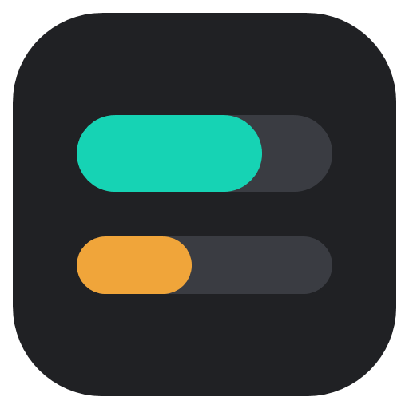
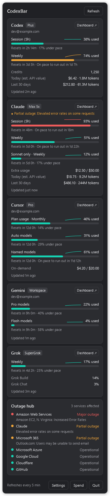
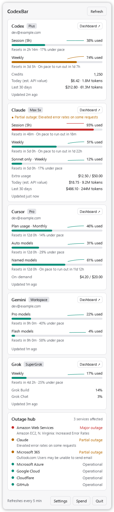
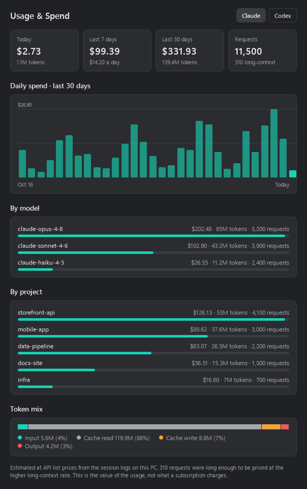
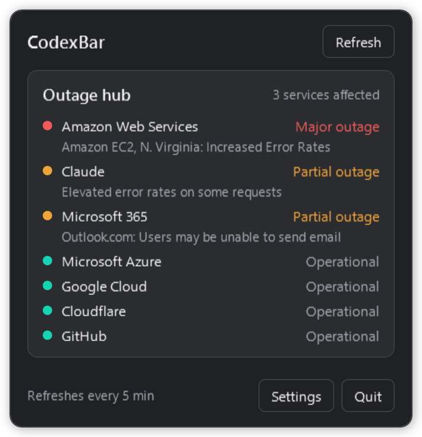
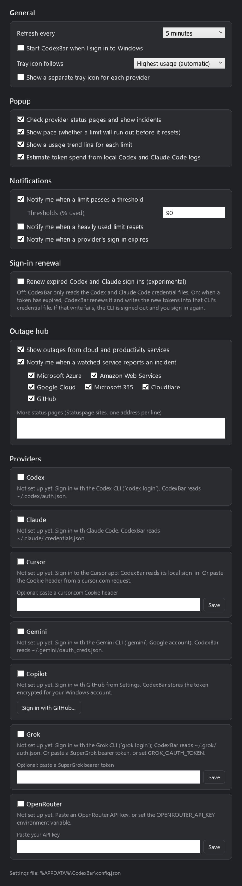

<p align="center">
  
</p>

<h1 align="center">CodexBar.Net</h1>

<p align="center">
  <strong>Your AI coding limits, one glance from the Windows tray.</strong>
</p>

<p align="center">
  <a href="LICENSE"></a>
  <a href="https://github.com/mahatab/codexbar.Net/releases/latest"></a>
  <a href="https://github.com/mahatab/codexbar.Net/actions/workflows/ci.yml"></a>
  
  
  
</p>

<p align="center">
  <a href="https://github.com/mahatab/codexbar.Net/releases/latest"><strong>⬇ Download for Windows</strong></a>
</p>

---

CodexBar.Net is a native **Windows notification-area app** that shows how much of your **Codex, Claude, Cursor, Gemini, Copilot, Grok and OpenRouter** limits you have used, when each one resets, and whether you will run out first. Its **outage hub** also watches Azure, AWS, Google Cloud, Microsoft 365, Cloudflare and GitHub, so one click tells you what is down. It is a C#/.NET rewrite of the core of [CodexBar](https://github.com/steipete/CodexBar), the macOS menu bar app by Peter Steinberger. It needs no Swift toolchain, no WSL and no CLI wrapper: one `CodexBar.exe`.

> [!IMPORTANT]
> **This is a partial port, not the full CodexBar.** It supports 7 of CodexBar's roughly 110 providers and has no browser-cookie import, multiple accounts, widgets, CLI, plugins or auto-update. See [What Is Missing](#what-is-missing) for the full list before you rely on it.

<p align="center">
  
  &nbsp;&nbsp;
  
</p>
<p align="center"><em>One card per provider, plus the outage hub — limits, resets, pace, trend lines, incidents and estimated spend (demo data)</em></p>

## How It Works

CodexBar.Net reuses the sign-ins you already have. It reads the credential file each CLI or app keeps on your PC, asks that provider's own usage endpoint how much quota is left, and draws the answer as a two-bar meter in the tray. Click the meter for the full popup.

<p align="center">
  
</p>
<p align="center"><em>The tray meter: normal, amber at 70%, red at 90%, an attention dot, and optional per-provider icons</em></p>

## Features

### Seven Providers
- **Codex** — session and weekly windows, model-specific extra limits, credits and plan
- **Claude** — session, weekly and model-scoped weekly windows, extra usage and plan
- **Cursor** — plan usage, Auto and named-model lanes, Grok Bot allowance, on-demand spend
- **Gemini** — Pro, Flash and Flash Lite daily quotas with plan detection
- **Copilot** — premium requests and chat quota through a GitHub device sign-in
- **Grok** — SuperGrok credits, per-product breakdown and prepaid balance
- **OpenRouter** — balance, account usage and key limit

### Pace
- **Will it last?** — each limit shows whether you are under pace, on pace, or on track to run out before the reset, with the time left at the current burn rate
- Stays quiet in the first few percent of a window, where a handful of requests would look like a wild burn rate

### Usage Trend Lines
- A small sparkline per limit: the last day for short windows, the last week for weekly and monthly ones
- History is a small local file of percentages and timestamps; nothing leaves your PC

### Provider Status
- Polls the **OpenAI, Claude, Cursor and GitHub** status pages and the **Google Workspace** incident feed for Gemini
- An incident appears on the affected card and adds an attention dot to the tray icon, so a failed refresh explains itself
- Click the status line to open the provider's status page

### Outage Hub 
- **Is it me or is it them?** — one card lists every watched service, with open incidents sorted to the top
- **Cloud and productivity platforms** — Microsoft Azure, Amazon Web Services, Google Cloud, Microsoft 365, Cloudflare and GitHub, next to your AI providers
- **Add your own** — paste any Statuspage address (for example `status.stripe.com`) in Settings
- **Incident alerts** — optional notification when a healthy service starts reporting an incident
- Every feed is public and unauthenticated; click a row to open that service's status page

### Usage & Spend 
- **Detailed local scan** — reads the session logs **Codex** and **Claude Code** already write on your PC and prices every request
- **Daily chart** — 30 days of spend as a bar chart, with today, 7-day and 30-day totals
- **By model and by project** — see which models and which folders the spend went to
- **Token mix** — input, cache reads, cache writes and output as one stacked bar
- **Long-context pricing** — requests whose prompt passes a model's threshold (272K for recent GPT models, 200K for Claude Sonnet 4 and 4.5) are priced at the higher rate for the whole request, as the providers bill them
- Prices come from the public [models.dev](https://models.dev) catalog, cached for a day, with a bundled table as the offline fallback
- An estimate of API list price, not what your subscription charges. Open it from **Spend** in the popup or the tray menu

### Notifications
- **Custom thresholds** — choose any set, for example 50, 75 and 90% used
- **Reset alerts** — optional notice when a heavily used limit resets
- **Sign-in alerts** — notice when a provider that was working starts rejecting its sign-in
- A provider's first reading never fires an alert

### Tray Icon
- **Follow the tightest limit** automatically, or pin the meter to one provider
- **One icon per provider** — optional, each marked with the provider's initial
- Follows the Windows light and dark taskbar

### Careful With Your Credentials
- **Read-only by default** — CLI credential files are read and never rewritten
- **Optional sign-in renewal** — off by default; when on, an expired Codex or Claude token is renewed and written back so the CLI stays signed in
- **Encrypted secrets** — API keys, pasted cookies and the GitHub token are encrypted with Windows DPAPI for your user account
- **No telemetry** — requests go only to each provider's own endpoints, public status feeds and the models.dev price list

## Screenshots

<p align="center">
  
</p>
<p align="center"><em>Usage &amp; Spend — daily chart, per-model and per-project breakdowns, and the token mix (demo data)</em></p>

<p align="center">
  
</p>
<p align="center"><em>Outage hub — open incidents first, then everything that is healthy (demo data)</em></p>

<p align="center">
  
</p>
<p align="center"><em>Settings — refresh interval, tray behavior, what the popup shows, notifications, outage hub sources and every provider</em></p>

## Supported Providers

| Provider | Where the sign-in comes from | What it shows | Status feed |
|----------|------------------------------|---------------|:-----------:|
| **Codex** | Codex CLI: `%USERPROFILE%\.codex\auth.json` (or `%CODEX_HOME%`) | Session, weekly, extra limits, credits, plan | ✅ |
| **Claude** | Claude Code: `%USERPROFILE%\.claude\.credentials.json` (or `%CLAUDE_CONFIG_DIR%`) | Session, weekly, model-scoped weekly, extra usage, plan | ✅ |
| **Cursor** | Cursor app's local sign-in, or a pasted cursor.com Cookie header | Plan usage, Auto / named models, Grok Bot, on-demand spend | ✅ |
| **Gemini** | Gemini CLI: `%USERPROFILE%\.gemini\oauth_creds.json` | Pro / Flash / Flash Lite quotas, plan | ✅ |
| **Copilot** | GitHub device sign-in from Settings | Premium requests, chat quota, plan | ✅ |
| **Grok** | Grok CLI: `%USERPROFILE%\.grok\auth.json`, a pasted bearer token, or `GROK_OAUTH_TOKEN` | Credits, product breakdown, prepaid balance | link only |
| **OpenRouter** | API key from Settings or `OPENROUTER_API_KEY` | Balance, account usage, key limit | link only |

A provider turns on by itself when its sign-in is found. Settings can switch any of them on or off.

### Outage Hub Sources

| Service | Public feed | What counts as an incident |
|---------|-------------|----------------------------|
| **Microsoft Azure** | Azure status RSS | Any item in the feed |
| **Amazon Web Services** | AWS Health current events | Any current event; a disruption is shown as a major outage |
| **Google Cloud** | Google Cloud incident history | Incidents without an end time |
| **Microsoft 365** | Microsoft service health posts (consumer services) | Posts that are not operational or restored |
| **Cloudflare**, **GitHub** | Statuspage | The page's own indicator |
| **Your own** | Any Statuspage site | The page's own indicator |

> **Microsoft 365 note:** the public feed covers consumer services such as Outlook.com, OneDrive and Teams. Tenant-specific service health needs an admin sign-in and is not read.

> **Gemini note:** Google stopped serving Gemini CLI sign-in for individual, AI Pro and Ultra accounts in June 2026. Workspace, education and Code Assist Standard/Enterprise accounts still work; CodexBar.Net says so plainly when it meets a consumer account.

## Quick Start

### Download
1. Get `CodexBar-<version>-win-x64.exe` (or `win-arm64`) from the [latest release](https://github.com/mahatab/codexbar.Net/releases/latest).
2. Run it. The build is not code-signed, so Windows SmartScreen may ask you to confirm: choose **More info → Run anyway**.
3. Look for the two-bar meter in the notification area. Windows hides new icons behind the `^` arrow; drag it onto the taskbar to keep it visible.

To install it for your user account with a Start Menu shortcut, download `install.ps1` next to the exe and run:

```powershell
./install.ps1 -StartAtLogin
```

### Use
- **Left-click** the icon for the popup; **right-click** for Refresh, Settings and Quit
- **F5** refreshes while the popup is open; **Esc** closes it
- **Dashboard ↗** on a card opens that provider's own usage page

## Building

Requires Windows 10 or 11 and the .NET 9 SDK.

```powershell
dotnet build CodexBar.Windows.sln
dotnet test CodexBar.Windows.sln
dotnet run --project src/CodexBar.App
```

A self-contained single-file exe that needs no .NET install:

```powershell
./Scripts/publish.ps1                  # win-x64 into ./publish
./Scripts/publish.ps1 -Runtime win-arm64
```

## Architecture

```
CodexBar.Windows.sln
├── src/CodexBar.Core        net9.0, no Windows UI dependencies
│   ├── Providers/           one file per provider, each with a pure ParseUsage function
│   ├── UsageStore           refresh loop, provider states, alerts
│   ├── StatusFetcher        Statuspage and Google Workspace incident feeds
│   ├── OutageHub            Azure, AWS, Google Cloud, Microsoft 365 and Statuspage sources
│   ├── Pace · HistoryStore  burn-rate projection and trend samples
│   ├── CostScanner          local log scan: per day, model and project, long-context pricing
│   ├── PriceCatalog         models.dev price cache
│   └── TokenRefresher       opt-in sign-in renewal
├── src/CodexBar.App         WPF popup and Settings, WinForms NotifyIcon for the tray
└── tests/CodexBar.Core.Tests  xunit; stubbed HTTP, temp folders, never a real account
```

### Tech Stack

| Layer | Technology |
|-------|-----------|
| Runtime | .NET 9 |
| UI | WPF (popup, Settings), Windows Forms `NotifyIcon` (tray) |
| Secret storage | Windows DPAPI, current user |
| Cursor sign-in | Read-only SQLite through Windows' built-in `winsqlite3.dll` |
| Tests | xunit, 71 tests |
| NuGet dependencies | None beyond the test framework |

## What Has Been Verified

CodexBar.Net is young. Being straight about what has and has not been exercised:

| Area | State |
|------|-------|
| Claude and Codex usage | Run against real accounts |
| Provider status, outage hub, pace, cost scan | Run against real data |
| Cursor, Gemini, Grok, Copilot, OpenRouter | Covered by tests with stubbed responses; not yet run against a real account |
| Sign-in renewal | Covered by tests only; treat as experimental |
| Notifications, per-provider tray icons | Built, lightly exercised |

If a provider misbehaves for you, please [open an issue](https://github.com/mahatab/codexbar.Net/issues) with the card's error text (never a token or cookie).

## What Is Missing

CodexBar.Net is **not a complete port**. It covers the everyday core of CodexBar for a handful of providers, and leaves a lot out. If you depend on anything in this table, the macOS app (or one of the WSL-based Windows wrappers) is the better choice today.

| Area | CodexBar (macOS) | CodexBar.Net |
|------|------------------|--------------|
| **Providers** | About 110 | 7: Codex, Claude, Cursor, Gemini, Copilot, Grok, OpenRouter |
| **Sign-in sources** | Several per provider with automatic fallback: OAuth, browser cookies, CLI probes, web sessions | One or two per provider; no fallback chain |
| **Browser cookie import** | Reads sessions from Safari, Chrome, Firefox and others | ❌ Not available. Cursor accepts a pasted cookie only |
| **Multiple accounts** | Several accounts per provider, workspaces, account switching | ❌ One account per provider |
| **Token renewal** | Built in, with its own credential cache | ⚠️ Opt-in and experimental |
| **Cost and spend** | Reporting periods, per-session detail, fast-mode and historical pricing, cross-machine Cursor cost | 30-day window with per-day, per-model and per-project totals at current list prices |
| **Usage history** | Burndown charts, utilization history, history-based forecasts | A one-week trend line per limit |
| **Provider status** | Component-level breakdown per status page | Overall indicator only |
| **Menu bar / tray icon** | Brand icons, custom layouts, per-metric choices | Two-bar meter, optional letter per provider |
| **Notifications** | Predictive warnings, reset celebrations, hooks | Thresholds, reset, sign-in expired, outage |
| **Widgets** | Desktop widgets | ❌ |
| **CLI and local server** | `codexbar usage`, `codexbar cost`, dashboard server | ❌ |
| **Plugins and custom providers** | JavaScript plugins, custom provider definitions | ❌ Custom status pages only |
| **Diagnostics** | Diagnostic export, storage footprint | ❌ |
| **Localization** | Multiple languages | ❌ English only |
| **Distribution** | Signed and notarized, auto-update, Homebrew | Unsigned exe and an install script; no auto-update |

Shallower even where a provider is supported:

- **Codex** — no workspace switching, no CLI fallback; `chatgpt_base_url` overrides in `config.toml` are ignored
- **Claude** — OAuth usage only; no web-session or CLI fallback, no Admin API spend, no saved limit-reset credits
- **Cursor** — no team or enterprise budgets, no dashboard cost feed; encrypted app sign-ins cannot be read
- **Gemini** — CLI quotas only; no Gemini app (web) limits
- **Grok** — CLI billing proxy only; no `grok agent` RPC, cookie or gRPC fallback, no reset coupons
- **Copilot** and **OpenRouter** — the basic quota and balance views only

One thing CodexBar.Net has that the macOS app does not: the **outage hub** for cloud and productivity services.
## Privacy

- Credential files that belong to other tools are read only, unless you switch on sign-in renewal.
- Settings, history and the price cache live in `%APPDATA%\CodexBar`. Secrets there are DPAPI-encrypted.
- No browser cookies are read from disk. A Cursor cookie is used only if you paste one.
- Network requests go to each enabled provider's usage endpoint, the public status feeds listed above, and `models.dev` for list prices.

## Credits

CodexBar.Net is an independent Windows port of [CodexBar](https://github.com/steipete/CodexBar) by [Peter Steinberger](https://github.com/steipete). The provider endpoints, response mappings and bundled price table follow that project's documentation and source. It is not affiliated with OpenAI, Anthropic, Cursor, Google, GitHub, xAI or OpenRouter.

## License

[MIT](LICENSE)
